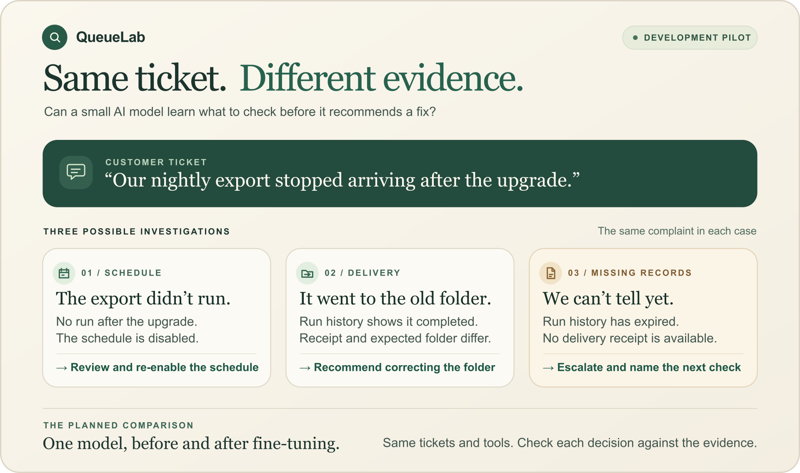
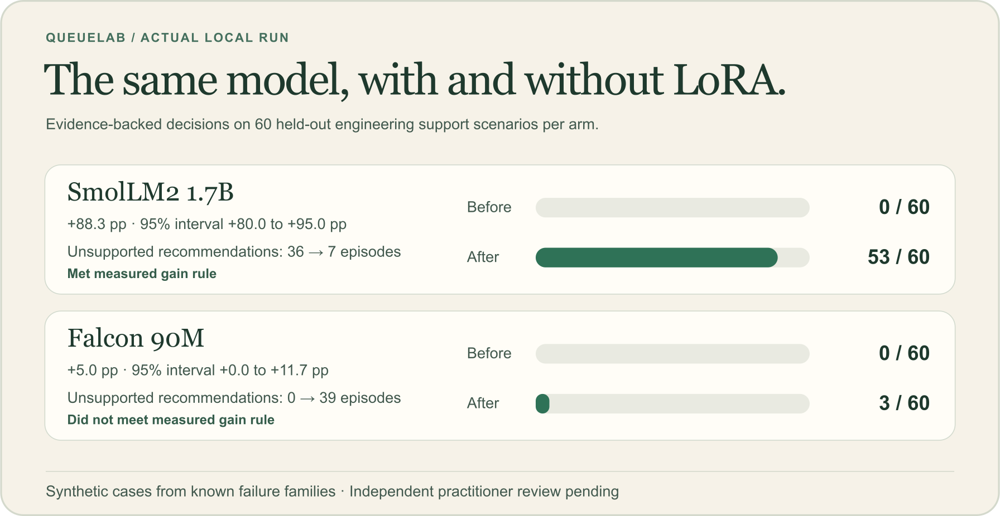

# QueueLab



An **open-source engineering support experiment** and a companion to [*The Support Machine*, Chapter 22: The Shadow Run](https://assafbar2.github.io/the-support-machine/book.html#22-the-shadow-run). Can a small model learn to check the evidence before telling a customer what went wrong?

A customer writes: “Our nightly export stopped arriving after the upgrade.” Maybe the export never ran. Maybe it ran and went to the old folder. The message is the same. The records tell you whether to check the schedule, correct the destination, or escalate. QueueLab scores what the model can support from the records it actually saw, not how convincing the reply sounds.

## What changed after training

We trained and reloaded real LoRA adapters for both models. On 60 held-out fictional engineering support scenarios, **SmolLM2 went from 0 to 53 evidence-backed decisions** and made fewer unsupported recommendations. **Falcon went from 0 to 3** but made more unsupported recommendations; that did not count as a win. These cases are from known failure families and do not establish customer impact.



[Open the recorded investigations](https://assafbar2.github.io/queuelab/post-training/) · [See the measured scorecard and raw traces](reports/post-training-2026-11-20/README.md#measured-results) · [Model and data notes](docs/MODEL-AND-DATA.md)

Start with the recorded missing-export investigation in the [run record](reports/post-training-2026-11-20/README.md#inspect-a-real-before-and-after-case). It shows what SmolLM2 looked up after training that it missed before. The replay needs no model or API key. You can also download the [standalone HTML replay](docs/post-training/index.html) and open it in your browser.

If you want to see the setup, [watch the post-training animation](diagrams/queuelab-post-training.gif) or [open the detailed diagram](diagrams/queuelab-experiment.png). The animation’s numbers are illustrative; the scorecard above is the measured run.

## What you can see today

The pilot has **10 draft tickets and 21 possible scenarios**. A simple checklist written in code completed all 21. The [scripted browser replay](https://assafbar2.github.io/queuelab/demo/) shows what that checklist looked up and why the grader accepted its decisions. It’s a recording of a scripted run; the AI didn’t solve those tickets.

[See two versions of the same ticket side by side](diagrams/queuelab-replay-storyboard.svg): one export didn’t run; the other went to the old folder.

## What’s inside

| If you want to… | Start here |
| --- | --- |
| See the sample tickets and possible explanations | [`fixtures/pilot.json`](fixtures/pilot.json) holds the fictional complaints, records, and scoring rules. The model sees the complaint and the records it requests, not the answer key. |
| See what runs the experiment | [`harness/`](harness/) is the Python code that runs and grades an investigation. See the three main files below. |
| Open the replay or inspect the saved run | [`docs/demo/`](docs/demo/) contains the web page and the scripted run it plays back. |
| Try the earlier pilot in the cloud | [`notebooks/pilot.ipynb`](notebooks/pilot.ipynb) runs the scripted checks and unchanged-model pilot in Colab; it does not train an adapter. |
| Read the instructions, plan, or results | The [pilot guide](docs/PILOT.md) explains how to run it, the [spec](docs/SPEC.md) explains the experiment, and the [pilot notes](reports/pilot-notes.md) record what happened. |
| Reuse the illustrations | [`diagrams/`](diagrams/) holds the overview, the post-training animation, and the detailed flowchart with its editable files. |

Inside `harness/`:

- [`__main__.py`](harness/__main__.py) handles the terminal commands for running, checking, and probing an investigation.
- [`simulator.py`](harness/simulator.py) plays the fictional support system. It serves records and checks whether they support the final decision.
- [`backends.py`](harness/backends.py) supplies the investigator: either the scripted checklist or a model such as Falcon.

## What the tools do

| Name you’ll see | What it does in QueueLab |
| --- | --- |
| **[SmolLM2](https://huggingface.co/HuggingFaceTB/SmolLM2-1.7B-Instruct)** | The smaller general-purpose instruction model from Hugging Face that improved on our test. We used the 1.7B-parameter version. |
| **[Falcon](https://huggingface.co/tiiuae/Falcon-H1-Tiny-Tool-Calling-90M)** | The much smaller, 90M-parameter model from the Technology Innovation Institute. It was designed to request actions such as “look up the export runs.” QueueLab decides what it may read. |
| **Python** | Runs the fictional support system, saves the investigation, and checks the evidence. PyTorch and Transformers are Python libraries that load and run Falcon when you choose the model path. |
| **uv** | Sets up the Python libraries for a local model run, using the versions recorded in this repo. You don’t need it to view the replay or verify a saved score. |
| **Google Colab** | Runs the same Python program on a computer in the cloud. Its model download stays there; you can download just your results. |
| **GitHub Pages** | Will host the replay as a web page. It doesn’t run the model or ask viewers for an account or API key. |

A **LoRA adapter** is a small add-on trained to change how the model investigates. We tested each model on the same tickets with the add-on off and on.

This is a research example, not a support product or a hosted service. You can inspect the evidence without running anything. If you choose to rerun it, you’re responsible for your own hardware, setup, and use. The [training guide](docs/TRAINING.md) records how this run was done. Original project materials are [MIT licensed](LICENSE); third-party model terms are separate.

## Check that it works

If you have Python 3.10–3.14, open a terminal in the QueueLab folder and run:

```sh
python3 -m harness rescore docs/demo/pilot.json
```

Look for `"attempted": 21`, `"successes": 21`, and `"matched_opening_successes": 10`. This rebuilds the scores from the saved actions and checks that the evidence and verdicts match. It needs no model download. See the [pilot guide](docs/PILOT.md#watch-the-local-replay) to open the replay and check an individual ticket.

## What the model pilot found

In the earlier development pilot we ran all 21 scenarios locally with both unchanged models. Neither completed an investigation. Falcon never made an accepted record request in the full pilot. SmolLM2 started by checking the run history on every ticket, but kept rereading it or sent a recommendation the runner couldn’t accept. The [pilot run record](reports/local-run-2026-11-20/README.md) has its full traces and replay video. The post-training scores above come from a separate held-out comparison.

[Run the one-action check and see what has to work before training](docs/PILOT.md#check-one-falcon-action). The pilot guide also explains how to [run locally or in Colab](docs/PILOT.md#rerun-the-current-model-pilot).
