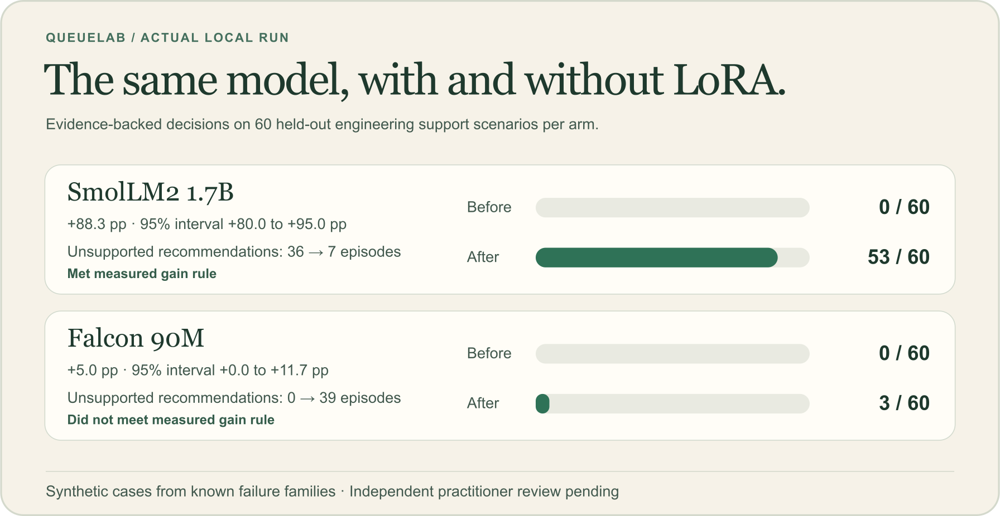

# QueueLab: local post-training run

On November 20, 2026, two frozen base models were supervised-fine-tuned with LoRA on a local Apple Silicon Mac. This run is separate from the initial development pilot and from the example numbers in the animation.

## Measured results



[Open the side-by-side replay](replay.html) · [Screenshot of an actual investigation](replay-screenshot.png) · [Download the vector scorecard](scorecard.svg) · [Reproduce the experiment](../../docs/TRAINING.md)

| Model | Adapter off | Adapter on | Paired lift (95% interval) | Unsupported recommendation episodes | Outcome |
| --- | ---: | ---: | --- | --- | --- |
| SmolLM2 1.7B | 0/60 | **53/60** | +88.3 pp (+80.0 to +95.0) | 36/60 → 7/60 | Met the measured gain rule |
| Falcon 90M | 0/60 | 3/60 | +5.0 pp (0.0 to +11.7) | 0/60 → 39/60 | Did not meet the rule |

SmolLM2 improved on 53 cases, regressed on none, and solved both sides of 23 of the 30 paired openings. All seven remaining failures were disabled-schedule cases. Falcon improved on three cases but made unsupported recommendations in 39; its unchanged baseline rarely emitted a usable action, so its zero unsupported recommendations does not indicate better support. An unsupported-recommendation flag is a property of this grader, not a count of false sentences.

## Training and raw records

| Model | Frozen base parameters | Trainable adapter parameters | Optimizer updates | Training time |
| --- | ---: | ---: | ---: | ---: |
| SmolLM2 1.7B | 1,711,376,384 | 1,572,864 | 180 | 5m 00s |
| Falcon 90M | 91,131,072 | 319,488 | 180 | 5m 46s |

Both runs changed all 48 LoRA B tensors and wrote separate, finite adapter checkpoints. The configuration, SHA-256 hashes, and training logs are included here; trained adapter binaries stay out of the source release. Validation action-token loss fell from about 0.460 to 0.001 for SmolLM2 and 0.936 to 0.010 for Falcon on the sampled validation batches. Loss is not the support outcome score.

- **SmolLM2:** [recipe](smol-adapter/adapter_config.json) · [training log](smol-train.log) · [update proof](smol-adapter/training-result.json) · [before trace](smol-eval/base.json) · [after trace](smol-eval/adapted.json) · [paired scorecard](smol-eval/comparison.json)
- **Falcon:** [recipe](falcon-adapter/adapter_config.json) · [training log](falcon-train.log) · [update proof](falcon-adapter/training-result.json) · [before trace](falcon-eval/base.json) · [after trace](falcon-eval/adapted.json) · [paired scorecard](falcon-eval/comparison.json)

## Inspect a real before-and-after case

In `holdout-02-1`, the customer was missing a nightly account extract. **Before**, SmolLM2 read the run history, then repeated the check or made invalid recommendations. It timed out. **After**, the same model read the run history and the delivery receipt, asked the customer for the expected folder when that record was unavailable, and recommended correcting the destination. It cited the completed run, old destination, and customer's expected destination. See the [before trace](smol-eval/base.json) and the [after trace](smol-eval/adapted.json), and search for `holdout-02-1`.

Not every case improved. In `holdout-01-1`, the adapted model saw that no run happened, checked delivery instead of the schedule, and guessed a delivery access problem. The grader rejected it. SmolLM2 solved only 5 of the 12 disabled-schedule cases; the other four failure families each scored 12/12 on this test.

## Evidence and limits

The data comprises 200 synthetic training investigations, 100 validation investigations, and 60 holdout investigations across 30 paired openings. The comparisons use the same pinned checkpoint, prompt, decoding, tools, and limits for the two arms. The adapted arm loads the saved adapter into a fresh base checkpoint. Both arms are rescored from the raw responses without a model.

The [split manifest](manifest.json), [holdout cases](holdout-cases.json), and [environment lock](environment.txt) are included. The [training guide](../../docs/TRAINING.md) explains how to reproduce the runs. Cases use known failure families and are checked by a deterministic reference; they have not had independent practitioner review. This is a bounded local synthetic experiment, not a production result or the full independent benchmark.

From the repository root, recompute both results without ML libraries or weights:

```sh
run=reports/post-training-2026-11-20
python3 -m training audit --data "$run" --results "$run/smol-eval"
python3 -m training audit --data "$run" --results "$run/falcon-eval"
```
